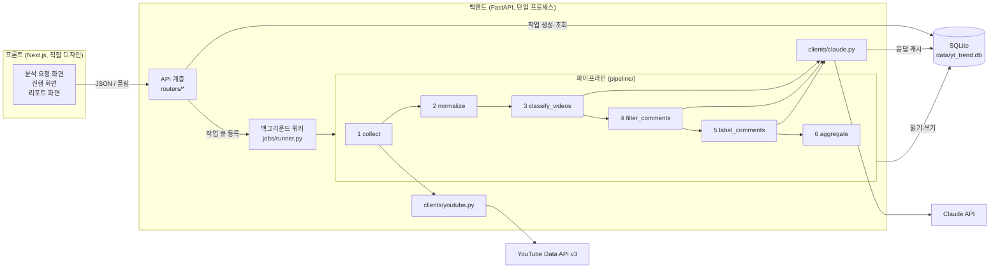
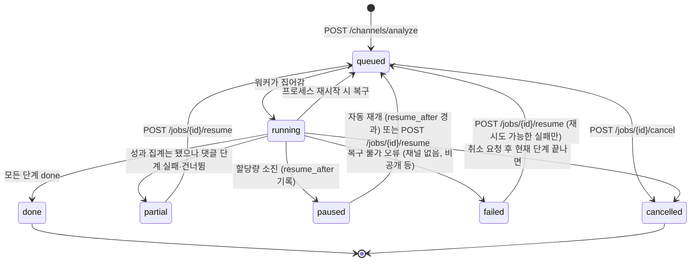

# 유튜브 채널 트렌드 분석 파이프라인 — 아키텍처 v0.1

- 작성일: 2026-09-09
- 전제: youtube-trend-decisions.md의 확정 사항
- 범위: 모듈 구성, 저장소 스키마, 작업 상태 흐름, 파이프라인 단계 명세, API 명세, Claude 호출 설계, 프론트 연동, 구현 순서
- 범위 밖: 프론트 화면 설계(직접 디자인), 분석 규칙 세부(0단계 후 결정)
- 개정: 2026-09-09 검수 반영. 해석 키에 model 추가, 댓글 커서 이원화, 조회 배수 정의 미결 환원,
  워커 블로킹 명시, refusal 처리, suspect_repeat 라벨링 포함, 라이브 판정 보강

---

## 현재 canonical 경계 — Stage 08 / Stage 09

2026-09-17 인간 확정 결정의 보존 복구. 현재 책임 경계의 정본은 이 절이다.

인간 확정 원칙:

**Stage 08까지 사실과 관계를 계산하고, Stage 09에서만 해석한다.**

Stage 08:

* 집계
* 수치 계산
* 관계/association 계산
* evidence 생성

여기까지다.

Stage 08이 사용자에게 보여줄 결론을 스스로 확정하거나 인과적 해석을 만드는 단계가 아니다.

Stage 09:

* Stage 08의 evidence를 바탕으로 의미 있는 결과를 선택
* 해석
* 사용자에게 설명할 insight 구성

Finding Engine의 기존 원칙인 association only / causal claim 금지를 유지한다.

과거 문서의 Stage 08 `집계 / 결론 문장 초안`, Stage 09 `리포트 조회` 표현은 현재 방법론 경계로는 outdated다. 아래 v0.1의 `aggregate`에서 결론 초안/문장 다듬기를 수행하는 설명은 과거 구현 설계 기록이며 현재 Stage 08의 허용 범위가 아니다. 현재 해석 책임은 Stage 09에 있다. 이번 복구는 구현 변경이나 Stage 09 구현 완료를 뜻하지 않는다.

현재 Reaction/Target 및 Phase 2 기준은 [Phase 1 checkpoint](../reaction-phase1-checkpoint.md), Feature 구조는 [Content Feature Structure](content-feature-structure.md)를 따른다. Relative Performance의 별도 고정 reference population 정책은 [Control Tower checkpoint](../reports/control-tower-checkpoint-2026-09-15.md)의 결정을 유지한다.

## 이하 v0.1 설계의 역사적 범위

이하 모듈·API·결론 생성 설명은 2026-09-09의 설계 기록이다. 위 현재 경계와 다르면 위 결정을 우선하며, 현재 방법론이나 구현 완료의 근거로 전용하지 않는다.

## 1. 설계 원칙

1. **화면과 분석의 분리.** 백엔드는 JSON만 내주고 HTML을 모른다. 프론트는 API만 알고 SQLite를 모른다.
2. **모든 단계는 다시 실행해도 안전하다.** 각 단계는 "이미 처리된 항목은 건너뛴다"로 동작한다. 재개, 증분 수집, 재시도가 전부 이 성질 하나에서 나온다.
3. **외부 호출 결과는 전부 저장한다.** YouTube 응답도 Claude 응답도 저장소에 남긴다. 같은 입력으로 같은 외부 호출을 두 번 하지 않는다.
4. **원본과 해석을 분리한다.** 댓글 원문은 한 번 저장되고 바뀌지 않는다. 감성·주제 같은 해석은 프롬프트 버전이 붙은 별도 행으로 쌓인다. 프롬프트를 바꾸면 해석만 다시 만든다.
5. **작업 상태는 파일에 있다.** 프로세스가 죽어도 SQLite의 작업 테이블이 진실이다.

---

## 2. 시스템 구성도



개념 문서의 8단계 중 [4] 필터, [5] 감성, [6] 주제는 Claude 호출을 공유하므로 구현에서는 4 filter_comments(규칙 + Claude 스팸 판정)와 5 label_comments(감성 + 주제를 한 호출로)로 합친다. [7] 결합과 [8] 리포트는 6 aggregate가 집계 테이블을 만들고 API가 그것을 읽어 주는 구조다.

---

## 3. 모듈 구성

```
yt-trend/
├── backend/
│   ├── app/
│   │   ├── main.py                 # FastAPI 앱 생성, 라우터 등록, 시작 시 워커 기동·미완 작업 복구
│   │   ├── config.py               # .env 로드 (API 키, DB 경로, 상한값)
│   │   ├── routers/
│   │   │   ├── channels.py         # 채널 목록, 분석 요청, 리포트, 영상·댓글 조회, 유형 체계 수정
│   │   │   └── jobs.py             # 작업 상태 조회, 재개, 취소
│   │   ├── jobs/
│   │   │   ├── runner.py           # 큐에서 작업을 꺼내 단계 순서대로 실행, 상태 전이, 예외 → 상태 변환
│   │   │   ├── states.py           # 작업·단계 상태 enum과 허용 전이표
│   │   │   └── errors.py           # QuotaExhausted, ChannelNotFound 등 파이프라인 예외
│   │   ├── pipeline/
│   │   │   ├── base.py             # Step 인터페이스: run(job, ctx) → StepResult, 진행률 보고
│   │   │   ├── collect.py          # 1 채널 해석 → 영상 목록 → 통계 스냅샷 → 댓글 증분 수집
│   │   │   ├── normalize.py        # 2 길이 축, 라이브 제외, 조회 배수·좋아요율·댓글율 계산
│   │   │   ├── classify_videos.py  # 3 유형 체계 제안 → 영상 라벨링 (Claude 2단)
│   │   │   ├── filter_comments.py  # 4 규칙 필터 → Claude 스팸·무관 판정
│   │   │   ├── label_comments.py   # 5 감성 + 주제 다중 라벨 (Claude, 묶음 호출)
│   │   │   └── aggregate.py        # 6 영상별·유형별 집계, 대표 댓글, 전후 비교, 결론 문장 초안
│   │   ├── clients/
│   │   │   ├── youtube.py          # API 래퍼. 할당량 계수, 페이지네이션, 429·403 → QuotaExhausted
│   │   │   └── claude.py           # SDK 래퍼. 구조화 출력, 캐시 조회·저장, 재시도, 프롬프트 버전 주입
│   │   ├── prompts/
│   │   │   ├── registry.py         # 프롬프트 이름 → (버전, 시스템 프롬프트, 출력 스키마)
│   │   │   ├── taxonomy_propose.md
│   │   │   ├── video_label.md
│   │   │   ├── comment_screen.md
│   │   │   ├── comment_label.md
│   │   │   └── conclusion_phrase.md
│   │   ├── db/
│   │   │   ├── schema.sql          # 4장의 테이블 정의
│   │   │   ├── connection.py       # 연결, WAL 모드, 마이그레이션 적용
│   │   │   └── repo/               # 테이블별 읽기·쓰기 함수 (channels, videos, comments, labels, jobs, cache)
│   │   └── schemas/                # Pydantic 모델: API 요청·응답, Claude 출력 스키마
│   ├── tests/
│   ├── data/                       # yt_trend.db (git 제외)
│   ├── .env                        # YOUTUBE_API_KEY, ANTHROPIC_API_KEY (git 제외)
│   └── pyproject.toml
└── frontend/                       # Next.js. 직접 디자인·구현. API 타입은 backend/schemas에서 생성
```

의존 방향은 한쪽이다. routers → jobs → pipeline → clients, db. 역방향 참조는 없다. pipeline은 FastAPI를 모르고, clients는 pipeline을 모른다.

---

## 4. 저장소 스키마 (SQLite)

WAL 모드로 연다. 읽기(API)와 쓰기(워커)가 같은 프로세스 안에서 동시에 일어나도 막히지 않는다. 시각은 모두 UTC ISO 8601 문자열이다.

### 4.1 원본 데이터

```sql
CREATE TABLE channels (
    channel_id        TEXT PRIMARY KEY,        -- UC로 시작하는 YouTube 채널 ID
    input_url         TEXT NOT NULL,           -- 사용자가 넣은 원래 URL
    handle            TEXT,                    -- @handle
    title             TEXT NOT NULL,
    uploads_playlist  TEXT NOT NULL,           -- UU로 시작. 영상 목록 수집에 사용
    subscriber_count  INTEGER,
    first_analyzed_at TEXT NOT NULL,
    last_analyzed_at  TEXT,
    last_job_id       TEXT
);

CREATE TABLE videos (
    video_id          TEXT PRIMARY KEY,
    channel_id        TEXT NOT NULL REFERENCES channels(channel_id),
    title             TEXT NOT NULL,
    description       TEXT,
    description_clean TEXT,                    -- 상용구 제거본. normalize가 채움
    tags_json         TEXT,                    -- JSON 배열
    duration_sec      INTEGER NOT NULL,
    published_at      TEXT NOT NULL,
    thumbnail_url     TEXT,
    is_live           INTEGER NOT NULL DEFAULT 0,   -- 라이브·프리미어. 집계 제외
    comments_disabled INTEGER NOT NULL DEFAULT 0,
    length_axis       TEXT,                    -- shorts | standard | long. normalize가 채움
    first_seen_at     TEXT NOT NULL,
    comments_newest_at TEXT,                   -- 이 시각보다 새로운 댓글은 전부 받았다 (위쪽 증분 기준)
    comments_oldest_at TEXT,                   -- 이 시각까지 거슬러 받았다 (아래쪽 backfill 기준)
    comments_complete  INTEGER NOT NULL DEFAULT 0  -- 1이면 이 영상의 댓글을 끝까지 받았다
);
CREATE INDEX idx_videos_channel ON videos(channel_id, published_at);

CREATE TABLE video_stats_snapshots (
    snapshot_id       INTEGER PRIMARY KEY AUTOINCREMENT,
    video_id          TEXT NOT NULL REFERENCES videos(video_id),
    job_id            TEXT NOT NULL,
    captured_at       TEXT NOT NULL,
    view_count        INTEGER,
    like_count        INTEGER,                 -- 비공개면 NULL
    comment_count     INTEGER,
    UNIQUE (video_id, job_id)                  -- 한 작업에 영상당 스냅샷 하나
);

CREATE TABLE comments (
    comment_id        TEXT PRIMARY KEY,
    video_id          TEXT NOT NULL REFERENCES videos(video_id),
    author_channel_id TEXT,
    author_name       TEXT,
    text              TEXT NOT NULL,           -- 원문. 절대 수정하지 않음
    published_at      TEXT NOT NULL,
    like_count        INTEGER NOT NULL DEFAULT 0,
    fetched_at        TEXT NOT NULL
);
CREATE INDEX idx_comments_video ON comments(video_id, published_at);
```

### 4.2 해석 데이터 (프롬프트 버전이 붙는다)

```sql
CREATE TABLE video_taxonomies (
    taxonomy_id       INTEGER PRIMARY KEY AUTOINCREMENT,
    channel_id        TEXT NOT NULL REFERENCES channels(channel_id),
    version           INTEGER NOT NULL,        -- 채널 내 1부터 증가. 사용자가 수정하면 새 버전
    source            TEXT NOT NULL,           -- claude | user
    prompt_version    TEXT,
    types_json        TEXT NOT NULL,           -- [{code, name, description}]
    created_at        TEXT NOT NULL,
    is_active         INTEGER NOT NULL DEFAULT 1,
    UNIQUE (channel_id, version)
);

CREATE TABLE video_type_labels (
    video_id          TEXT NOT NULL REFERENCES videos(video_id),
    taxonomy_id       INTEGER NOT NULL REFERENCES video_taxonomies(taxonomy_id),
    prompt_version    TEXT NOT NULL,
    model             TEXT NOT NULL,
    type_code         TEXT NOT NULL,
    confidence        REAL,
    rationale         TEXT,
    labeled_at        TEXT NOT NULL,
    PRIMARY KEY (video_id, taxonomy_id, prompt_version, model)
);

CREATE TABLE comment_screens (                 -- 4단계 결과
    comment_id        TEXT NOT NULL REFERENCES comments(comment_id),
    prompt_version    TEXT NOT NULL,
    model             TEXT NOT NULL,           -- 규칙만으로 확정한 행은 'rule'
    rule_flags_json   TEXT,                    -- ["url", "repeat", "emoji_only"]
    verdict           TEXT NOT NULL,           -- keep | spam | promo | irrelevant | suspect_repeat
    screened_at       TEXT NOT NULL,
    PRIMARY KEY (comment_id, prompt_version, model)
);

CREATE TABLE comment_labels (                  -- 5단계 결과
    comment_id        TEXT NOT NULL REFERENCES comments(comment_id),
    prompt_version    TEXT NOT NULL,
    model             TEXT NOT NULL,
    sentiment         TEXT NOT NULL,           -- positive | negative | neutral
    sentiment_confidence REAL,
    is_sarcasm_suspect INTEGER NOT NULL DEFAULT 0,
    topics_json       TEXT NOT NULL,           -- ["T1", "T3"]
    labeled_at        TEXT NOT NULL,
    PRIMARY KEY (comment_id, prompt_version, model)
);
CREATE INDEX idx_comment_labels_version ON comment_labels(prompt_version, model);
```

세 해석 테이블의 키는 모두 **(대상, 프롬프트 버전, 모델)**로 통일한다. 프롬프트를 올리거나 모델을
바꾸면 새 행이 쌓이고 옛 행은 그대로 남는다. 5.2의 건너뛰기 규칙이 이 키를 그대로 쓰기 때문에,
8.1이 말하는 "모델을 바꾸면 다시 분류된다"가 실제로 성립한다. 모델을 키에서 빼면 캐시는 미스가
나는데 결과 테이블은 옛 행을 그대로 갖고 있어, 다시 분류되지 않으면서 호출만 나가는 상태가 된다.

### 4.3 집계 데이터 (6단계가 매 작업마다 다시 만든다)

```sql
CREATE TABLE video_metrics (
    video_id          TEXT NOT NULL,
    job_id            TEXT NOT NULL,
    view_multiple     REAL,                    -- 조회 배수
    views_per_day     REAL,
    like_rate         REAL,
    comment_rate      REAL,
    valid_comment_count INTEGER,
    positive_ratio    REAL,
    negative_ratio    REAL,
    topic_counts_json TEXT,                    -- {"T1": 12, ...}
    top_positive_json TEXT,                    -- [comment_id × 3]
    top_negative_json TEXT,
    PRIMARY KEY (video_id, job_id)
);

CREATE TABLE type_metrics (
    channel_id        TEXT NOT NULL,
    job_id            TEXT NOT NULL,
    taxonomy_id       INTEGER NOT NULL,
    type_code         TEXT NOT NULL,
    length_axis       TEXT,                    -- NULL이면 길이 축 통합
    video_count       INTEGER,
    avg_view_multiple REAL,
    avg_like_rate     REAL,
    avg_comment_rate  REAL,
    positive_ratio    REAL,
    top_positive_topics_json TEXT,
    top_negative_topics_json TEXT,
    PRIMARY KEY (channel_id, job_id, taxonomy_id, type_code, length_axis)
);

CREATE TABLE reports (
    channel_id        TEXT NOT NULL,
    job_id            TEXT NOT NULL,
    taxonomy_id       INTEGER NOT NULL,
    prompt_version_set_json TEXT NOT NULL,     -- 이 리포트를 만든 프롬프트 버전들
    conclusion_draft  TEXT,                    -- 규칙으로 채운 문장 틀
    conclusion_text   TEXT,                    -- Claude가 다듬은 문장
    recent_vs_prior_json TEXT,                 -- 전후 비교
    completeness      TEXT NOT NULL,           -- full | performance_only
    built_at          TEXT NOT NULL,
    PRIMARY KEY (channel_id, job_id)
);
```

### 4.4 작업과 캐시

```sql
CREATE TABLE jobs (
    job_id            TEXT PRIMARY KEY,        -- ULID
    channel_id        TEXT,                    -- 채널 해석 전에는 NULL
    input_url         TEXT NOT NULL,
    status            TEXT NOT NULL,           -- 5장 상태
    current_step      TEXT,
    error_code        TEXT,
    error_message     TEXT,
    resume_after      TEXT,                    -- 일시 정지 시 재개 가능 시각
    created_at        TEXT NOT NULL,
    started_at        TEXT,
    finished_at       TEXT,
    quota_used        INTEGER NOT NULL DEFAULT 0,
    claude_input_tokens  INTEGER NOT NULL DEFAULT 0,
    claude_output_tokens INTEGER NOT NULL DEFAULT 0
);

CREATE TABLE job_steps (
    job_id            TEXT NOT NULL REFERENCES jobs(job_id),
    step              TEXT NOT NULL,           -- collect | normalize | classify_videos | ...
    status            TEXT NOT NULL,           -- pending | running | done | failed | skipped
    progress_done     INTEGER NOT NULL DEFAULT 0,
    progress_total    INTEGER,
    detail            TEXT,                    -- 진행 화면에 보여줄 한 줄
    started_at        TEXT,
    finished_at       TEXT,
    error_message     TEXT,
    PRIMARY KEY (job_id, step)
);

CREATE TABLE llm_cache (
    cache_key         TEXT PRIMARY KEY,        -- sha256(prompt_name + prompt_version + model + 입력 본문)
    prompt_name       TEXT NOT NULL,
    prompt_version    TEXT NOT NULL,
    model             TEXT NOT NULL,
    response_json     TEXT NOT NULL,           -- 파싱된 구조화 출력
    input_tokens      INTEGER,
    output_tokens     INTEGER,
    created_at        TEXT NOT NULL
);

CREATE TABLE quota_ledger (                    -- YouTube 할당량 일별 사용량
    day_pt            TEXT PRIMARY KEY,        -- 태평양 시간 기준 날짜
    units_used        INTEGER NOT NULL DEFAULT 0
);
```

---

## 5. 작업 상태 흐름

### 5.1 작업 상태



허용 전이는 jobs/states.py의 표 하나로 관리하고, 표에 없는 전이는 예외를 던진다.

### 5.2 단계 상태와 재개 규칙

작업 하나는 단계 6개를 순서대로 실행한다. 각 단계는 job_steps에 자기 행을 가진다.

| 단계 | 재실행 시 건너뛰는 기준 | 실패 시 작업 상태 |
|---|---|---|
| collect | 영상: uploads 재생목록의 ID가 videos에 이미 있으면 메타 수집 생략, 통계 스냅샷은 항상 새로 기록. 댓글: comments_newest_at 이후(위쪽)와 comments_oldest_at 이전(아래쪽) 두 방향 | 할당량 → paused. 채널 없음 → failed |
| normalize | 항상 전체 재계산 (싸다) | 실패 시 failed (코드 버그) |
| classify_videos | 활성 taxonomy가 있고 사용자 수정본이면 제안 생략. 라벨은 (video_id, taxonomy_id, prompt_version, model) 없는 영상만 | Claude 오류 지속 → failed (재개 가능) |
| filter_comments | (comment_id, prompt_version, model) 없는 댓글만. 라이브·프리미어 영상의 댓글은 제외 | 미분류 10% 초과 → 단계 failed, 작업은 partial로 계속 |
| label_comments | (comment_id, prompt_version, model) 없는 댓글 중 verdict가 keep 또는 suspect_repeat인 것 | 위와 같음 |
| aggregate | 항상 전체 재계산. 댓글 단계가 failed면 completeness=performance_only | 실패 시 failed |

재개는 "status가 done이 아닌 첫 단계부터 다시 실행"이다. 각 단계가 건너뛰기 규칙을 갖고 있으므로 done인 단계를 다시 돌려도 결과는 같다.

### 5.3 워커 동작

- FastAPI 시작 시 워커를 하나 띄운다. 큐는 jobs 테이블의 status=queued를 created_at 순으로 읽는 것이다. 별도 큐 서버 없음.
- **워커는 이벤트 루프 위에서 돌지 않는다.** google-api-python-client, sqlite3, anthropic 동기 클라이언트는 전부 블로킹 호출이라, 워커를 그냥 asyncio 태스크로 띄우면 수집·분류가 도는 동안 이벤트 루프가 막혀 `GET /jobs/{id}`가 응답하지 않는다. 진행률을 보려고 2초 폴링을 두었는데(10장) 정작 진행 중일 때 폴링이 멈추는 형태로 나타난다. 워커 루프 전체를 전용 스레드(또는 `asyncio.to_thread`)로 내리고, 파이프라인 코드는 동기로 유지한다. DB 연결은 스레드마다 따로 연다.
- 동시 실행은 1개. 본인만 쓰므로 충분하다. 두 번째 요청은 queued로 대기한다.
- 시작 시 status=running으로 남은 작업(이전 프로세스가 죽은 것)을 queued로 되돌리고, 그 작업의 running 단계를 pending으로 되돌린다.
- paused 작업은 워커가 주기적으로(5분) resume_after를 확인해 지나면 queued로 바꾼다.
- 취소는 플래그다. 단계 경계에서 확인하고, 단계 안에서는 묶음(댓글 20개 호출) 경계에서 확인한다.

### 5.4 진행률

각 단계는 progress_done / progress_total을 갱신하고 detail에 한 줄을 쓴다. 프론트는 이것을 그대로 보여준다.

| 단계 | total | detail 예 |
|---|---|---|
| collect | 영상 수 + 댓글 페이지 수(추정) | "댓글 수집 중 · 영상 23/47 · 1,240개" |
| classify_videos | 영상 수 | "유형 체계 제안 완료 (6개) · 라벨링 31/47" |
| filter_comments | 댓글 수 / 20 | "스팸 판정 340/1,240" |
| label_comments | 유효 댓글 수 / 20 | "감성·주제 분류 900/1,180" |
| aggregate | 1 | "집계 중" |

---

## 6. 파이프라인 단계 명세

### 6.1 collect

입력: input_url. 출력: channels 1행, videos N행, video_stats_snapshots N행, comments 증분.

1. **채널 해석.** URL 형식 세 가지를 채널 ID로 바꾼다. @handle은 channels.list(forHandle), /channel/UC…는 그대로, /c/name과 /user/name은 channels.list(forUsername) 후 실패하면 search(1회, 100유닛)로 폴백. 결과에서 uploads 재생목록 ID를 얻는다.
2. **영상 목록.** playlistItems.list(uploads, 50개/페이지, 1유닛). 영상 50개 이하 채널은 1~2호출. 상한 설정값(기본 500)까지만.
3. **영상 메타·통계.** videos.list(id 50개씩, part=snippet,contentDetails,statistics,liveStreamingDetails, 1유닛/호출). 새 영상은 videos에 넣고, 모든 영상의 통계는 스냅샷으로 기록한다. **라이브 판정은 liveStreamingDetails의 존재만으로 하지 않는다** — 프리미어로 공개한 일반 영상도 이 필드를 갖는 것으로 보이며, 그대로 두면 프리미어 공개가 잦은 채널에서 정규 영상이 통째로 유형화·집계에서 빠진다. `actualStartTime`과 `actualEndTime`의 간격이 영상 길이보다 뚜렷하게 길 때만 is_live=1로 두고, 0단계에서 실제 응답을 확인해 규칙을 확정한다.
4. **댓글 증분 — 커서 두 개.** 영상마다 commentThreads.list(order=time, 100개/페이지, 1유닛). comments_disabled인 영상은 건너뛰고 표시. 답글은 수집하지 않는다.
   - **위쪽(신규):** comments_newest_at보다 오래된 댓글이 나오는 페이지에서 멈춘다.
   - **아래쪽(backfill):** comments_complete=0이면 comments_oldest_at 이전을 이어서 받는다. 영상당 상한 2,000에 걸려 중단된 구간이 여기서 채워진다.
   - **커서는 페이지 단위로 커밋한다.** 페이지를 저장한 직후에만 comments_newest_at·comments_oldest_at을 갱신한다. 단계 종료 시점에 한꺼번에 쓰면, 할당량 소진으로 영상 중간에 멈췄을 때 못 받은 구간을 다음 실행이 영원히 건너뛴다.
   - 끝까지 받았으면 comments_complete=1. 상한만으로 중단한 영상은 0으로 남아 다음 조사에서 이어받는다.
5. **할당량.** 호출마다 quota_ledger에 더한다. 하루 한도(기본 10,000)의 95%에 닿거나 API가 quotaExceeded를 돌려주면 QuotaExhausted를 던지고, 워커가 paused로 바꾸며 resume_after를 다음 태평양 자정으로 기록한다. 그때까지 저장한 것은 그대로 남는다.

영상 50개, 댓글 평균 300개 채널의 할당량: 채널 1 + 목록 1 + 메타 1 + 댓글 약 150 = 약 155유닛. 여유가 크다.

### 6.2 normalize

입력: videos, 최신 스냅샷. 출력: videos.length_axis, description_clean, video_metrics의 성과 열.

- **길이 축.** duration_sec ≤ 180 → shorts, ≤ 1200 → standard, 그 외 → long. 경계는 설정값.
- **상용구 제거.** 채널 내 영상 30% 이상에 동일하게 나타나는 줄을 설명에서 제거한 description_clean을 만든다.
- **조회 배수 — 분모는 0단계에서 정한다(미결).** 개념 문서 5.2는 "같은 기간 업로드 영상들의 중앙값"이었다. 이 문서의 초안은 "해당 영상 전후 N개의 중앙값"으로 좁혔는데, 그러면 한 유형을 시리즈로 몰아 올린 구간에서 분모가 그 유형 자신이 되어 배수가 1로 눌린다. 유튜브 채널은 기획을 묶어 연재하는 경우가 많아, 리포트의 머리 문장인 "가장 조회 배수가 높은 유형"이 실제로는 "가장 드문드문 올린 유형"을 뽑아낼 수 있다. 길이 축까지 나누면(영상 50개 × 축 3개) 창 안의 표본이 몇 개 남지 않는 문제도 겹친다.
  - 후보: ① 같은 길이 축 · 같은 분기의 중앙값 ② 전후 N개 창에서 **자기 유형을 뺀** 중앙값 ③ 길이 축 통합 후 축을 보정 계수로 처리.
  - 0단계에서 첫 채널의 업로드 간격·유형 분포·길이 축 분포를 보고 하나를 고른 뒤 이 절을 확정한다. 그때까지 구현은 ①을 기본값으로 두고 계수를 설정값으로 뺀다.
  - 라이브·프리미어는 모집단에서 뺀다. 리포트의 caveats에 "근사치"임을 계속 표기한다.
- **좋아요율, 댓글율, 일평균 조회.** 정의대로. like_count가 NULL이면 좋아요율도 NULL.

### 6.3 classify_videos (Claude 2단)

입력: videos(라이브 제외), description_clean. 출력: video_taxonomies 1행(필요 시), video_type_labels N행.

1. **체계 제안.** 활성 taxonomy가 없거나 source=claude이고 새 영상이 30% 이상 늘었으면 제안을 다시 받는다. 제목·정제된 설명 앞 200자·태그를 영상 전부 넘기고 유형 5~8개(code, name, description)를 받는다. 사용자가 수정한 taxonomy(source=user)는 건드리지 않는다.
2. **라벨링.** 영상 10개씩 묶어 활성 taxonomy와 함께 넘기고 영상마다 type_code, confidence, rationale을 받는다.

프론트에서 taxonomy를 수정하면(PUT) 새 버전이 만들어지고, 다음 작업에서 라벨링만 다시 돈다.

### 6.4 filter_comments

입력: comments 중 현재 (prompt_version, model)로 comment_screens가 없는 것. 라이브·프리미어 영상의 댓글은 집계에서 빠지므로 여기서도 제외한다 — 넣으면 쓰이지 않을 분류에 호출 비용만 나간다. 출력: comment_screens.

1. **규칙.** URL 포함, 같은 작성자 동일 문장 3회 이상, 이모지·기호만, 3자 이하 정형 문구. 규칙에 걸린 것은 Claude를 거치지 않고 verdict를 확정한다(동일 문장 반복은 suspect_repeat로 남기고 이후 단계는 진행).
2. **Claude.** 규칙 통과분을 20개씩 묶어 keep / promo / irrelevant를 받는다.

### 6.5 label_comments

입력: verdict가 keep 또는 suspect_repeat이고 현재 (prompt_version, model)로 comment_labels가 없는 댓글. 출력: comment_labels.

suspect_repeat을 넣는 이유는 6.4가 "동일 문장 반복은 suspect_repeat로 남기고 이후 단계는 진행"이라고 정했기 때문이다. keep만 대상으로 하면 그 댓글은 감성·주제에서 통째로 빠진다. 집계(6.6)에서는 suspect_repeat을 유효 댓글 수에 넣되 대표 댓글 후보에서는 뺀다.

댓글 20개를 영상 제목과 함께 묶어 한 호출로 보낸다. 댓글마다 sentiment, confidence, is_sarcasm_suspect, topics(T1~T9 다중)를 받는다. 영상 제목을 같이 주는 이유는 "너무 길다"가 영상 길이 얘기인지 문장 얘기인지 같은 맥락 판단 때문이다.

### 6.6 aggregate

입력: 위 전부. 출력: video_metrics 완성, type_metrics, reports.

1. 영상별: 유효 댓글 수, 긍정·부정 비율, 주제별 언급 수, 대표 댓글(긍정·부정 각 상위 3, 댓글 좋아요 수 기준, 확신도 가중은 미결).
2. 유형별 × 길이 축별, 그리고 유형별 통합.
3. 전후 비교: 최근 N개 영상과 그 이전 N개의 유형별 조회 배수·긍정 비율.
4. 결론 문장 초안: 규칙으로 채운다. "가장 조회 배수가 높은 유형 X, 그 유형 긍정 댓글의 최다 주제 Y, 부정 비율이 가장 높은 유형 Z, 그 유형 부정 댓글의 최다 주제 W"를 틀에 넣는다. 인사이트 산출에서 제외할 주제(T8 감정·응원 등)는 **설정값 목록**으로 두고 기본값은 비운다 — 어떤 주제를 뺄지는 결정 문서 3장의 미결 사항이라 여기서 확정하지 않는다. 그다음 Claude에 초안과 수치를 주고 문장만 다듬게 한다. 수치를 바꾸거나 새 인과를 넣지 말라고 지시하고, 출력이 초안의 수치와 다르면 초안을 그대로 쓴다.
5. 댓글 단계가 실패했으면 completeness=performance_only로 기록하고 피드백 부분은 비운다.

---

## 7. API 명세

기본 경로 /api/v1. 응답은 JSON. 오류는 `{ "error": { "code": "...", "message": "..." } }`. 인증 없음(로컬, 본인만).

### 7.1 분석 요청과 작업

| 메서드 | 경로 | 설명 |
|---|---|---|
| POST | /channels/analyze | body `{ "url": "..." }`. 작업을 만들고 202와 `{ "job_id" }` 반환. 같은 채널의 queued·running 작업이 있으면 그 job_id를 돌려준다 |
| GET | /jobs/{job_id} | 작업 상태와 단계별 진행률 |
| POST | /jobs/{job_id}/resume | paused·partial → queued. failed는 **재시도 가능한 것만**(9장에서 "재개 가능"으로 표시된 error_code). channel_not_found처럼 재개 불가인 실패는 409와 재개 불가 사유를 돌려준다 |
| POST | /jobs/{job_id}/cancel | 취소 플래그 |
| GET | /jobs?channel_id=&limit= | 작업 이력 |

GET /jobs/{job_id} 응답:

```json
{
  "job_id": "01J...",
  "channel_id": "UC...",
  "status": "running",
  "current_step": "label_comments",
  "steps": [
    { "step": "collect", "status": "done", "progress_done": 47, "progress_total": 47, "detail": "영상 47개 · 댓글 1,240개" },
    { "step": "normalize", "status": "done" },
    { "step": "classify_videos", "status": "done", "detail": "유형 6개 · 라벨 47/47" },
    { "step": "filter_comments", "status": "done", "progress_done": 62, "progress_total": 62 },
    { "step": "label_comments", "status": "running", "progress_done": 31, "progress_total": 59, "detail": "감성·주제 분류 620/1,180" },
    { "step": "aggregate", "status": "pending" }
  ],
  "error": null,
  "resume_after": null,
  "usage": { "quota_units": 155, "claude_input_tokens": 412000, "claude_output_tokens": 38000 },
  "created_at": "...", "started_at": "...", "finished_at": null
}
```

### 7.2 채널과 리포트

| 메서드 | 경로 | 설명 |
|---|---|---|
| GET | /channels | 분석한 채널 목록. 최근 작업 상태 포함 |
| GET | /channels/{channel_id} | 채널 요약, 활성 taxonomy, 최근 리포트 존재 여부 |
| GET | /channels/{channel_id}/report?job_id= | 리포트 본체. job_id 생략 시 최신 완료 작업. 5.8 정보 구조 순서대로 |
| GET | /channels/{channel_id}/videos?job_id=&type=&length_axis=&sort= | 영상 표 (탐색용) |
| GET | /channels/{channel_id}/videos/{video_id} | 영상 상세: 스냅샷 이력, 댓글 집계, 대표 댓글 |
| GET | /channels/{channel_id}/comments?video_id=&sentiment=&topic=&verdict=&cursor= | 댓글 원문 목록. 리포트에서 근거를 눌러 볼 때 |
| GET | /channels/{channel_id}/taxonomies | 유형 체계 버전 목록 |
| PUT | /channels/{channel_id}/taxonomy | body `{ "types": [{code, name, description}] }`. 새 버전 생성(source=user), 활성화. 라벨 재실행은 별도 분석 요청 |
| GET | /channels/{channel_id}/snapshots?video_id= | 통계 스냅샷 시계열 |

GET /channels/{id}/report 응답 골격:

```json
{
  "channel": { "channel_id": "...", "title": "...", "subscriber_count": 0, "analyzed_at": "...", "video_count": 47, "period": { "from": "...", "to": "..." } },
  "completeness": "full",
  "conclusion": { "text": "...", "draft": "...", "basis": { "best_type": "T-code", "best_topic": "T1", "worst_type": "...", "worst_topic": "T3" } },
  "taxonomy": { "taxonomy_id": 3, "version": 2, "source": "user", "types": [ { "code": "howto", "name": "튜토리얼", "description": "..." } ] },
  "type_distribution": [ { "type_code": "howto", "video_count": 18, "share": 0.38 } ],
  "type_performance": [
    { "type_code": "howto", "length_axis": null, "video_count": 18, "avg_view_multiple": 1.42, "avg_like_rate": 0.041, "avg_comment_rate": 0.0032, "positive_ratio": 0.71 }
  ],
  "type_feedback": [
    { "type_code": "howto",
      "positive_topics": [ { "topic": "T1", "count": 120, "examples": [ { "comment_id": "...", "text": "...", "like_count": 45, "video_id": "..." } ] } ],
      "negative_topics": [ { "topic": "T3", "count": 34, "examples": [ ] } ],
      "requests": [ { "comment_id": "...", "text": "..." } ]
    }
  ],
  "recent_vs_prior": { "window": 15, "by_type": [ { "type_code": "howto", "recent": { "avg_view_multiple": 1.6, "positive_ratio": 0.75 }, "prior": { "avg_view_multiple": 1.2, "positive_ratio": 0.68 } } ] },
  "caveats": [ "조회 배수는 누적 조회수 기준 근사치", "댓글 비활성 영상 3개는 피드백 분석에서 제외", "댓글은 시청자 일부의 의견" ],
  "prompt_versions": { "comment_label": "v3", "video_label": "v2" }
}
```

프론트 타입은 backend/schemas의 Pydantic 모델에서 OpenAPI를 뽑아 생성한다. 손으로 두 번 쓰지 않는다.

---

## 8. Claude 호출 설계

### 8.1 공통

- **SDK:** anthropic 파이썬 SDK. 원시 HTTP 사용 안 함.
- **모델:** claude-opus-5 기본. 댓글 분류처럼 양이 많은 호출은 비용을 보고 claude-sonnet-5로 내릴 수 있게 **프롬프트 레지스트리에서만** 프롬프트별 모델을 지정한다(.env에 모델을 또 두지 않는다 — 설정이 두 곳이면 어긋난다). 모델은 캐시 키와 세 해석 테이블의 PK 양쪽에 들어가므로, 바꾸면 실제로 다시 분류된다.
- **사고:** 지정하지 않으면 claude-opus-5는 adaptive thinking이 켜진 채로 돈다. 끄지 말고 effort로 조절한다(아래). 비용 추정에 thinking 토큰이 포함된다는 점을 jobs의 토큰 누적으로 확인한다.
- **구조화 출력:** 모든 호출은 Pydantic 스키마를 넘겨 client.messages.parse로 받는다. JSON 파싱 실패가 구조적으로 없다.
- **사고와 노력:** 분류 호출은 output_config effort를 low로, 체계 제안과 결론 다듬기는 medium으로. 최신 모델은 temperature 같은 샘플링 파라미터를 받지 않으므로, 개념 문서의 "temperature 0" 항목은 폐기하고, 재현성은 해석 테이블의 키(프롬프트 버전 + 모델)로 확보한다 — 같은 키면 재분류하지 않으므로 한 번 붙은 라벨이 실행마다 흔들리지 않는다.
- **프롬프트 캐시:** 시스템 프롬프트(지시문 + 주제 체계 + 유형 체계)는 요청마다 같으므로 cache_control을 붙인다. 댓글 묶음만 바뀐다. usage.cache_read_input_tokens가 0이면 두 가지를 본다 — 프롬프트에 가변 요소(시각, 작업 ID)가 섞였거나, **프리픽스가 캐시 최소 길이에 못 미친다.** 최소 길이는 모델에 따라 512~4096 토큰이고 미달이면 조용히 캐시되지 않으므로, T1~T9 정의만 붙인 comment_label 시스템 프롬프트는 실제 토큰 수를 재보고 판단한다.
- **재시도:** SDK 기본 재시도(2회)에 더해 래퍼에서 429·5xx는 지수 백오프로 최대 3회. 400은 즉시 실패(프롬프트 버그).
- **거절(refusal):** 안전 분류기가 요청을 거절하면 예외가 아니라 **HTTP 200에 stop_reason="refusal"**로 온다. 유튜브 댓글에는 욕설·혐오 표현이 섞이므로 이 경로는 반드시 밟는다. 응답 내용을 읽기 전에 stop_reason을 먼저 확인하고, 거절이면 해당 묶음을 반으로 쪼개 한 번 더 시도한 뒤 그래도 거절되는 댓글만 미분류로 남긴다. claude-opus-5를 쓰므로 서버 사이드 fallbacks를 기본으로 켠다.
- **캐시:** 호출 전 llm_cache를 조회하고, 응답을 저장한다. 키는 프롬프트 이름 + 버전 + 모델 + 입력 본문의 해시. **이 캐시는 비용 절감 장치가 아니다** — 묶음 단위 해시라 댓글 20개 구성이 한 건만 달라져도 미스가 난다. 재개할 때 비용이 두 배가 되지 않는 진짜 이유는 세 해석 테이블의 PK로 이미 처리한 항목이 걸러지기 때문이다. llm_cache가 하는 일은 같은 묶음을 연속 재시도할 때의 중복 호출 방지와 원 응답 감사 기록이다.
- **사용량 기록:** 응답의 usage를 jobs에 누적한다.
- **Batches API:** 댓글이 2,000개를 넘는 채널은 filter_comments와 label_comments를 Batches API로 보내는 선택지를 둔다. 비용이 절반이고 백그라운드 작업이라 지연은 문제가 아니다. 단, 진행률이 묶음 단위로만 보이고 최대 24시간 걸릴 수 있어 첫 버전에서는 끄고 설정값으로 켠다.

### 8.2 프롬프트 목록

| 이름 | 단계 | 입력 | 출력 스키마 | 묶음 크기 |
|---|---|---|---|---|
| taxonomy_propose | classify_videos | 채널명, 영상 전부의 제목·정제 설명 200자·태그·길이 축 | `{ types: [{code, name, description}] }` 5~8개 | 채널당 1회 |
| video_label | classify_videos | taxonomy, 영상 10개의 제목·설명·태그 | `{ labels: [{video_id, type_code, confidence, rationale}] }` | 10 |
| comment_screen | filter_comments | 영상 제목, 댓글 20개 (묶음 안 1~20 번호로 제시) | `{ results: [{idx, verdict}] }` verdict ∈ keep/promo/irrelevant | 20 |
| comment_label | label_comments | 영상 제목, 주제 체계 T1~T9 정의, 댓글 20개 (묶음 안 1~20 번호로 제시) | `{ results: [{idx, sentiment, confidence, sarcasm_suspect, topics}] }` | 20 |
| conclusion_phrase | aggregate | 결론 초안, 근거 수치, 어조 지침(제3자 분석가) | `{ text }` | 채널당 1회 |

묶음 호출은 comment_id(`UgxKREW…` 같은 긴 문자열)를 모델에게 되돌려 받지 않고 묶음 안의 1~20 번호로 주고받는다. 코드가 번호를 comment_id로 되돌린다. 출력 토큰이 줄고, 9장의 "입력 ID와 안 맞음" 재호출도 줄어든다.

프롬프트 파일마다 머리에 버전과 변경 이력을 적는다. 버전을 올리면 해당 프롬프트의 결과는 전부 다시 만들어지고, 옛 버전 결과는 테이블에 남는다.

### 8.3 프롬프트 작성 원칙

- 출력 스키마가 형식을 강제하므로 프롬프트에는 "JSON으로 답하라" 같은 형식 지시를 넣지 않는다. 판단 기준만 쓴다.
- 반어 예시, 한국어 댓글 특유의 표현("ㅋㅋ"가 긍정인지 조롱인지 맥락 판단), 영상 제목을 참고하라는 지시를 comment_label에 넣는다.
- conclusion_phrase에는 "수치를 바꾸지 말 것, 초안에 없는 원인을 추가하지 말 것"을 명시하고, 코드에서 초안의 수치가 출력에 그대로 있는지 검사한다.

---

## 9. 실패 처리 구현

| 상황 | 감지 위치 | 처리 |
|---|---|---|
| URL 형식 오류, 채널 없음, 비공개 | collect 1단계 | ChannelNotFound → failed, error_code=channel_not_found. 재개 불가 |
| 댓글 비활성 영상 | collect 4단계 | videos.comments_disabled=1, 건너뜀. 실패 아님 |
| 채널 전체 댓글 비활성 | filter_comments 진입 | 단계 skipped, aggregate가 performance_only로 마무리 → partial |
| YouTube 403 quotaExceeded 또는 장부 95% | clients/youtube | QuotaExhausted → paused, resume_after=다음 태평양 자정. 워커가 자동 재개 |
| YouTube 5xx·네트워크 | clients/youtube | 3회 재시도 후 failed, error_code=youtube_unavailable. 재개 가능 |
| Claude 429·5xx | clients/claude | 백오프 3회. 실패한 묶음은 건너뛰고 미분류로 기록, 단계 끝에 미분류 비율 검사 |
| 미분류 10% 초과 | filter/label 단계 끝 | 단계 failed, 작업은 계속 → partial. 재개 시 미분류만 다시 |
| Claude 400 | clients/claude | 즉시 failed, error_code=prompt_error. 코드 수정 필요 |
| Claude 거절 (200 + stop_reason=refusal) | clients/claude | 예외가 아니므로 stop_reason을 먼저 검사. 묶음을 반으로 쪼개 1회 재시도, 남는 댓글만 미분류로 기록 |
| 구조화 출력이 입력 번호와 안 맞음 (누락·중복) | clients/claude | 해당 묶음 1회 재호출, 그래도 안 맞으면 누락분만 미분류 |
| 프로세스 종료 | main.py 시작 시 | running → queued, running 단계 → pending |
| 취소 | 단계·묶음 경계 | cancelled. 저장된 데이터는 유지 |

---

## 10. 프론트 연동

프론트 설계는 직접 하되, API 관점에서 화면 세 가지가 필요하다.

| 화면 | 호출 | 갱신 |
|---|---|---|
| 채널 목록 + 분석 요청 | GET /channels, POST /channels/analyze | 요청 후 작업 화면으로 이동 |
| 작업 진행 | GET /jobs/{id} | 2초 폴링. status가 done·partial·failed·paused·cancelled면 중단. paused는 resume_after와 재개 버튼, failed는 error와 재개 가능 여부 |
| 리포트 | GET /channels/{id}/report, /videos, /comments, PUT /taxonomy | 정적. 댓글 근거는 클릭 시 /comments로 원문 조회 |

폴링으로 충분하다. 본인만 쓰고 작업이 동시에 하나라 SSE나 WebSocket은 과하다.

---

## 11. 로컬 실행

```
backend/.env
  YOUTUBE_API_KEY=...
  ANTHROPIC_API_KEY=...
  DB_PATH=./data/yt_trend.db
  MAX_VIDEOS_PER_CHANNEL=500
  MAX_COMMENTS_PER_VIDEO=2000
  YOUTUBE_DAILY_QUOTA=10000
  USE_BATCHES_API=false

모델은 .env가 아니라 prompts/registry.py가 프롬프트별로 정한다(8.1). 설정 자리를 하나로 둔다.

cd backend && uvicorn app.main:app --reload --port 8000
cd frontend && npm run dev   # http://localhost:3000, API는 8000으로 프록시
```

DB 파일이 없으면 시작 시 schema.sql로 만든다. 마이그레이션은 schema_version 테이블에 번호를 두고 순서대로 적용한다.

---

## 12. 구현 순서

각 단계는 그 자체로 검증 가능한 산출물을 남긴다.

1. **db + clients/youtube + collect.** 채널 URL 하나로 SQLite에 영상·스냅샷·댓글이 쌓이는 것까지. 개념 문서의 0단계 데이터 확인이 여기서 끝난다. 실제 필드와 분포를 보고 미결 사항을 정한다.
2. **normalize + aggregate(성과 부분만) + GET /report.** 댓글 분석 없이 성과 리포트가 나온다. completeness=performance_only 경로를 먼저 검증하는 셈이다.
3. **jobs 워커 + 상태 흐름 + GET /jobs.** 1~2를 백그라운드 작업으로 감싸고 재시작 복구, 일시 정지, 재개를 시험한다.
4. **clients/claude + classify_videos.** 유형 체계 제안과 라벨링. 결과를 사람이 훑고 프롬프트를 고친다.
5. **filter_comments + label_comments.** 댓글 200건을 직접 채점해 정확도를 잰다.
6. **aggregate 완성 + 결론 문장 + 나머지 API.**
7. **프론트 연동.** OpenAPI에서 타입 생성 후 세 화면 연결.

3단계까지 끝나면 Claude 없이도 도구가 돌아간다. Claude 관련 실패는 4단계 이후에만 영향을 준다.
